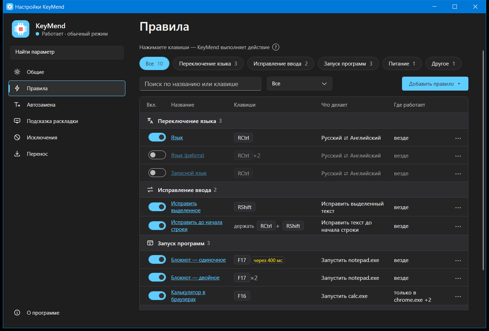
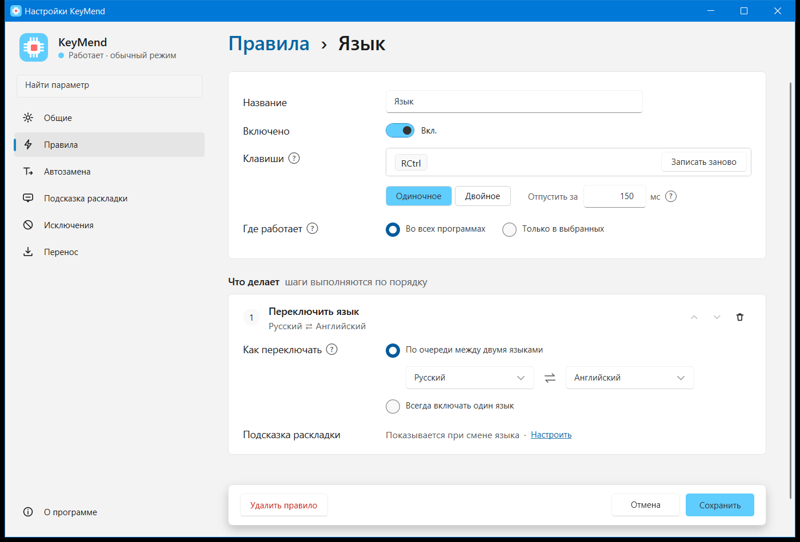
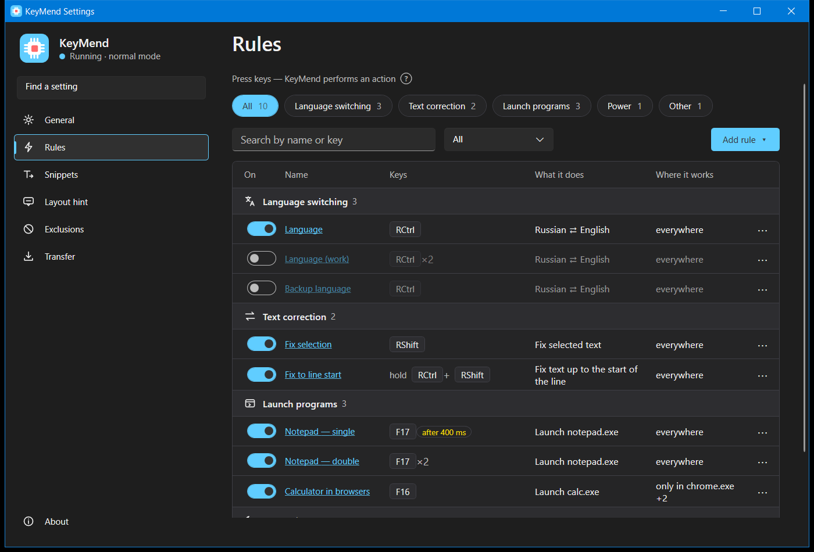
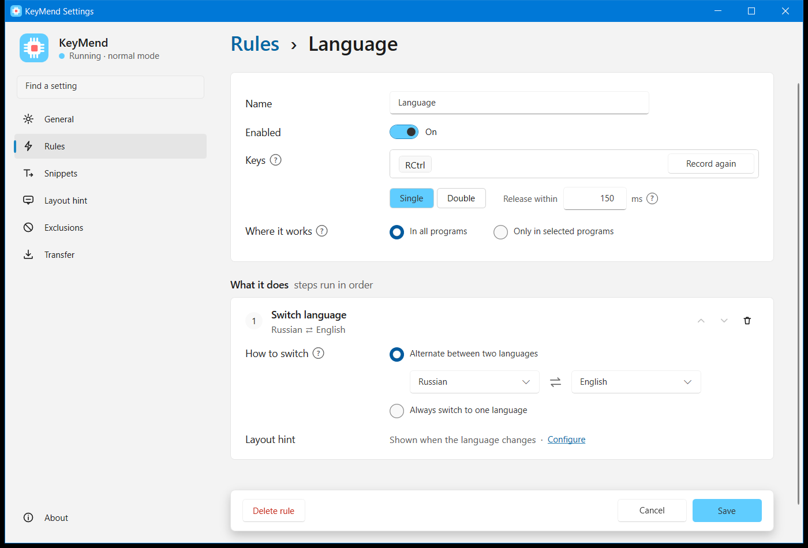

<div align="center">

# KeyMend

Утилита в трее Windows: переключение языка, исправление раскладки, автозамена и действия по горячим клавишам.

**Windows 10/11 x64** &nbsp;·&nbsp; **.NET 10** &nbsp;·&nbsp; **без сети**

[Возможности](#возможности) · [Установка](#установка) · [Клавиши по умолчанию](#клавиши-по-умолчанию) · [Приватность и данные](#приватность-и-данные) · [Разработка](#разработка) · [English ↓](#english)

</div>

## Возможности

KeyMend работает рядом с часами и оставляет ввод в ваших руках: нажали клавиши — программа выполнила действие. Всё настраивается в удобном окне, а у каждого параметра есть локальная подсказка.

| Функция | Как помогает |
|---|---|
|  **Переключение языка** | Короткое нажатие правого Ctrl переключает язык ввода. Рядом с кареткой ненадолго появляется подсказка — в том числе при обычной смене языка в Windows. |
|  **Исправление раскладки** | Хотели набрать `Git`, а получилось `Пше` — одно нажатие перепишет выделенный текст или строку до каретки. Повтор вернёт исходный текст. |
|  **Автозамена** | Сокращения срабатывают в любой раскладке: `дд ` превращается в «Добрый день!». После вставки можно автоматически нажать Ctrl+Enter или другое сочетание клавиш. |
|  **Секреты** | Пароли хранятся отдельно и защищаются Windows (DPAPI), вставляются через буфер обмена и не попадают в открытый файл настроек. Для переноса есть отдельный пароль экспорта. |
|  **Запуск программ** | Правило может запустить `.exe`, `.ps1` или `.cmd` с нужными аргументами. Скрипты не получают права администратора даже в режиме администратора KeyMend. |
|  **Питание** | Сон, гибернация, выключение, перезагрузка, блокировка или выход из системы — сразу или через таймер. Таймер можно отменить или поставить заново одной кнопкой. |
|  **Исключения** | Для отдельных программ можно отключить любую функцию — например, исправление ввода в игре или автозамену в окне RDP. |
|  **Перенос настроек** | Правила, сокращения и скрипты сохраняются в один `.keymend` и переносятся на другой компьютер; секреты выгружаются только под паролем. |

Интерфейс — на русском и английском, с автозапуском и режимом администратора для работы в окнах с повышенными правами.

<p align="center"></p>
<p align="center"><em>Тёмная тема. Раздел «Правила»: все действия в одной таблице.</em></p>

<p align="center"></p>
<p align="center"><em>Светлая тема. Редактор правила: клавиши, область действия и цепочка шагов.</em></p>

## Установка

1. Скачайте [KeyMend-Setup.exe](https://github.com/avfil/KeyMend/releases/latest/download/KeyMend-Setup.exe) и запустите его. Это установщик для текущего пользователя; права администратора не требуются.
2. Программа установится в `%LocalAppData%\Programs\KeyMend`, а ярлык появится в меню «Пуск».
3. Запустите KeyMend из меню «Пуск». При первом запуске откроются настройки: выберите язык интерфейса и проверьте правила по умолчанию.
4. Чтобы программа стартовала вместе с Windows, включите автозапуск в «Общих» или в меню значка в трее.

Портативная версия: скачайте [KeyMend-win-x64.zip](https://github.com/avfil/KeyMend/releases/latest/download/KeyMend-win-x64.zip), распакуйте в удобную папку и запустите `KeyMend.exe`. Настройки и секреты в любом случае хранятся в профиле пользователя.

**Обновление.** Закройте KeyMend через меню значка в трее («Выход») и запустите новый установщик. Настройки, сокращения и секреты сохранятся. Если включён автозапуск от администратора, перед обновлением выключите его в меню трея, а после установки включите заново.

**Удаление.** Откройте «Параметры» → «Приложения» → «Установленные приложения» → KeyMend → «Удалить». Удаляются программа и ярлык; пользовательские настройки, секреты и журнал сохраняются. Перед удалением выключите автозапуск от администратора.

## Клавиши по умолчанию

| Клавиши | Действие |
|---|---|
| **Правый Ctrl**, отпустить до 150 мс | Переключить язык |
| **Правый Shift**, отпустить до 300 мс | Исправить выделенный текст |
| **Правый Ctrl + правый Shift** | Исправить строку от каретки до её начала |

Клавиши можно нажимать и отпускать в любом порядке. Правый Ctrl не мешает обычным сочетаниям левой рукой: для переключения нужно нажать и отпустить только его. Все клавиши можно изменить в настройках.

## Приватность и данные

KeyMend не подключается к интернету, не отправляет данные и не записывает набранный текст. Буфер ввода существует только в памяти, ограничен короткой фразой и очищается при смене окна, клике мышью, Enter, Esc и навигации.

**Журнал работы.** По умолчанию выключен; включить его можно в «Общих». Выключенный журнал не пишет на диск даже ошибки и удаляет имеющиеся файлы. Включённый журнал хранится 7 дней и содержит только технические события — без набранного текста, текстов сокращений, секретов и вывода скриптов.

| Что | Где лежит |
|---|---|
| Установленная программа | `%LocalAppData%\Programs\KeyMend\KeyMend.exe`; у портативной копии — папка, из которой запущен `KeyMend.exe` |
| Настройки и правила | `%AppData%\KeyMend\settings.json` |
| Скрипты | `%AppData%\KeyMend\scripts\` |
| Секреты | `%AppData%\KeyMend\secrets.dat`, DPAPI CurrentUser; другой пользователь Windows их прочитать не сможет |
| Резервные копии перед импортом | `%AppData%\KeyMend\backup\`, последние 10 |
| Журнал работы | `%LocalAppData%\KeyMend\logs\`, файл на день, хранение 7 дней |
| Копия для режима администратора | `C:\Program Files\KeyMend\<имя пользователя>\` |

Сама программа пишет в реестр только пункт обычного автозапуска: `HKEY_CURRENT_USER\Software\Microsoft\Windows\CurrentVersion\Run`, значение `KeyMend`. Автозапуск от администратора использует задачу Планировщика, а не реестр. Установщик дополнительно создаёт стандартные записи Windows о ярлыках и возможности удаления программы.

## Разработка

Требуется .NET 10 SDK.

```powershell
git clone https://github.com/avfil/KeyMend
cd KeyMend
dotnet run --project src/KeyMend   # запуск из исходников
```

```powershell
dotnet build -c Release   # строгая сборка, как в CI
dotnet test               # тесты
dotnet format             # форматирование
```

Повторяемые артефакты релиза собираются командой `.\scripts\publish-release.ps1`. Для установщика нужен Inno Setup; без него скрипт с параметром `-SkipInstaller` собирает только портативный ZIP. Готовые файлы появляются в `artifacts\installer\`.

## Лицензия

Проект распространяется по лицензии [MIT](LICENSE): разрешены использование, изменение и распространение, включая коммерческое применение, при сохранении уведомления об авторстве и текста лицензии.

---

<h2 id="english">English</h2>

<div align="center">

A Windows tray utility for language switching, layout correction, text expansion and hotkey-driven actions.

**Windows 10/11 x64** &nbsp;·&nbsp; **.NET 10** &nbsp;·&nbsp; **offline**

[Features](#features) · [Installation](#installation) · [Default keys](#default-keys) · [Privacy and data](#privacy-and-data) · [Development](#development) · [Русский ↑](#keymend)

</div>

## Features

KeyMend lives in the system tray: press a key, and it performs an action. Everything is configured in a clean settings window, and every option has a local tooltip.

| Feature | What it does |
|---|---|
|  **Language switching** | Tap Right Ctrl to switch the input language. A compact hint appears near the caret, including when Windows itself changes the layout. |
|  **Layout correction** | Wanted to type `Git`, but got `Пше`? One keypress rewrites the selected text or the current line up to the caret. Press again to restore the original text. |
|  **Text expansion** | Abbreviations work in any keyboard layout: type `gm ` and KeyMend inserts “Good morning!”, optionally followed by Ctrl+Enter or another key sequence. |
|  **Secrets** | Passwords are stored separately and protected by Windows DPAPI. They are inserted through the clipboard and never remain in the plain settings file. Export uses its own password. |
|  **Program launcher** | Rules can run `.exe`, `.ps1` or `.cmd` files with arguments. Scripts never gain administrator rights, even when KeyMend itself is elevated. |
|  **Power actions** | Sleep, hibernate, shut down, restart, lock or sign out immediately or through a timer. The timer can be cancelled or set again with one keypress. |
|  **Exclusions** | Disable any feature for selected applications — for example, layout correction in a game or text expansion in an RDP window. |
|  **Settings transfer** | Save rules, snippets and scripts as a single `.keymend` file and move them to another computer; secrets are exported only under a password. |

The interface is available in Russian and English. Autostart and administrator mode are built in.

<p align="center"></p>
<p align="center"><em>Dark theme. The Rules page keeps every action in one table.</em></p>

<p align="center"></p>
<p align="center"><em>Light theme. The rule editor: hotkeys, scope and a sequence of steps.</em></p>

## Installation

1. Download [KeyMend-Setup.exe](https://github.com/avfil/KeyMend/releases/latest/download/KeyMend-Setup.exe) and run it. The installer works for the current user and does not require administrator rights.
2. KeyMend is installed to `%LocalAppData%\Programs\KeyMend`, and its shortcut appears in the Start menu.
3. Start KeyMend from the Start menu. The settings window opens on first launch: choose the interface language and review the default rules.
4. To start KeyMend with Windows, enable autostart in General or from the tray icon menu.

Portable version: download [KeyMend-win-x64.zip](https://github.com/avfil/KeyMend/releases/latest/download/KeyMend-win-x64.zip), extract it to any folder and run `KeyMend.exe`. Settings and secrets are still stored in the current Windows profile.

**Updating.** Quit KeyMend from the tray icon menu (“Exit”) and run the new installer. Your settings, snippets and secrets are preserved. If administrator autostart is enabled, turn it off from the tray menu before updating and turn it on again after installation.

**Uninstalling.** Open Settings → Apps → Installed apps → KeyMend → Uninstall. This removes the program and shortcut while preserving user settings, secrets and logs. Turn off administrator autostart before uninstalling.

## Default keys

| Keys | Action |
|---|---|
| **Right Ctrl**, released within 150 ms | Switch language |
| **Right Shift**, released within 300 ms | Correct the selected text |
| **Right Ctrl + Right Shift** | Correct the line from the caret to its beginning |

Keys may be pressed and released in any order. Right Ctrl does not interfere with ordinary left-hand shortcuts: language switching requires tapping and releasing it alone. Every key can be changed in the settings.

## Privacy and data

KeyMend does not connect to the internet, send telemetry or record typed text. The input buffer exists only in memory, is limited to a short phrase and is cleared when the window changes or when you click, press Enter, press Esc or navigate.

**Activity log.** It is disabled by default; you can enable it in General. A disabled log writes nothing to disk, not even errors, and removes existing log files. An enabled log is kept for 7 days and contains only technical events — never typed text, snippet text, secrets or script output.

| Data | Location |
|---|---|
| Installed program | `%LocalAppData%\Programs\KeyMend\KeyMend.exe`; for the portable copy, the folder containing `KeyMend.exe` |
| Settings and rules | `%AppData%\KeyMend\settings.json` |
| Scripts | `%AppData%\KeyMend\scripts\` |
| Secrets | `%AppData%\KeyMend\secrets.dat`, DPAPI CurrentUser; another Windows user cannot read them |
| Backups before import | `%AppData%\KeyMend\backup\`, the latest 10 |
| Activity log | `%LocalAppData%\KeyMend\logs\`, one file per day, kept for 7 days |
| Administrator-mode copy | `C:\Program Files\KeyMend\<user name>\` |

The program itself writes only the normal autostart entry to the registry: `HKEY_CURRENT_USER\Software\Microsoft\Windows\CurrentVersion\Run`, value `KeyMend`. Administrator autostart uses a Task Scheduler task instead of the registry. The installer additionally creates the standard Windows entries for Start-menu shortcuts and program removal.

## Development

.NET 10 SDK is required.

```powershell
git clone https://github.com/avfil/KeyMend
cd KeyMend
dotnet run --project src/KeyMend   # run from source
```

```powershell
dotnet build -c Release   # strict, CI-like build
dotnet test               # tests
dotnet format             # formatting
```

Build repeatable release artifacts with `.\scripts\publish-release.ps1`. Inno Setup is required for the installer; with the `-SkipInstaller` switch, the script builds only the portable ZIP. Finished files are placed in `artifacts\installer\`.

## License

KeyMend is distributed under the [MIT License](LICENSE). You may use, modify and distribute it, including commercially, as long as the copyright notice and license text are preserved.
